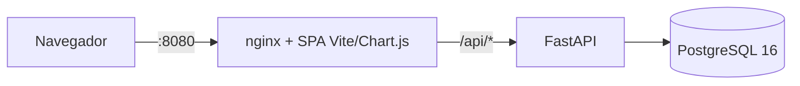

# Matriz Energética · Universidad EAN

Dashboard con dos secciones: **Matriz energética de Colombia** (filtros por territorio, tipo de energía, potencial y periodo) y **Universidad EAN** (consumo, generación solar y cargas, por edificio **Legacy** y **Nogal**).

## Arquitectura



| Capa | Tecnología | Carpeta |
|---|---|---|
| Frontend | Vite + JS vanilla + Chart.js (servido por nginx) | `frontend/` |
| Backend | FastAPI + SQLAlchemy 2 | `backend/` |
| Datos | PostgreSQL (SQLite en local/tests) | volumen `pgdata` |
| CI | GitHub Actions: pytest, build front, build Docker | `.github/` |

## Inicio rápido

```bash
cp .env.example .env      # cambia POSTGRES_PASSWORD
docker compose up --build # http://localhost:8080
```

Desarrollo sin Docker:
```bash
cd backend && pip install -r requirements.txt && uvicorn app.main:app --reload   # :8000 (SQLite)
cd frontend && npm install && npm run dev                                        # :5173 (proxy /api → :8000)
make test
```

## API (`/api/v1`)

| Endpoint | Uso |
|---|---|
| `GET /meta` | Catálogos para poblar filtros |
| `GET /matriz/agregado` | Totales por `agrupar=recurso\|potencial\|territorio` |
| `GET /matriz/tendencia` | Serie mensual por categoría |
| `GET /matriz/export.csv` | CSV (mismos filtros, UTF-8 con BOM para Excel) |
| `GET /ean/mensual?edificio=todos\|legacy\|nogal` | Consumo y generación mensual |
| `GET /ean/cargas?edificio=…` | Distribución de cargas |
| `GET /ean/export.csv?edificio=…&meses=1&meses=2` | CSV EAN |

Filtros de matriz: `level`, `territorio`, `recurso`, `subtipo`, `potencial` (repetible), `desde`, `hasta` (`YYYY-MM`), `agrupar`.

## Publicación

**Red local:** `docker compose up -d` publica el puerto 8080 en todas las interfaces; desde otro dispositivo de la misma red abre `http://IP_DEL_PC:8080`.

**GitHub Pages (demo estática):** Pages solo sirve archivos, no ejecuta FastAPI ni PostgreSQL. El workflow `pages.yml` exporta los datos a `data.json` (`backend/scripts/export_static.py`) y compila el frontend con `VITE_STATIC=true`, de modo que el navegador calcula los mismos filtros y CSV sin backend. En *Settings → Pages* la fuente debe ser **GitHub Actions**.

## Decisiones

- **Tema fijo con 2 opciones** (Día / Noche): botón manual guardado en `localStorage`; se eliminó `prefers-color-scheme`. El único breakpoint responsive es `max-width: 820px`.
- **Datos sintéticos**: `backend/app/seed.py` replica los datos del boceto (municipios A/B de ejemplo). Para producción, reemplazar por un ETL con fuentes reales (UPME, XM, medidores EAN) que escriba en las mismas tablas.
- Esquema con `create_all` al iniciar; pasar a Alembic cuando se estabilice.

## Flujo GitHub

```bash
git init && git add . && git commit -m "feat: dashboard matriz energética"
git branch -M main && git remote add origin <URL> && git push -u origin main
```
Ramas `feature/*` → PR a `develop` → `main`. El CI debe pasar antes de hacer merge.
